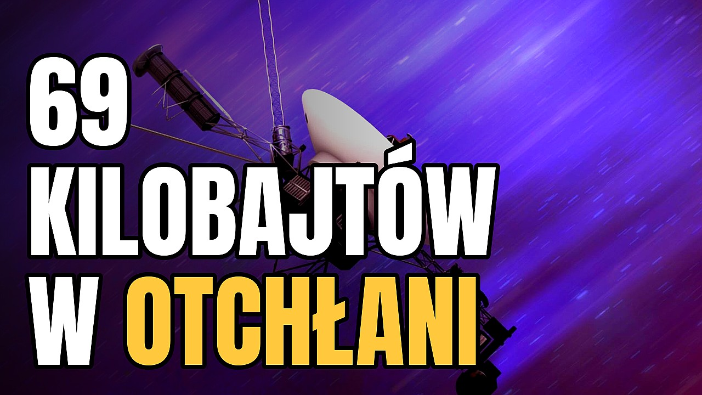
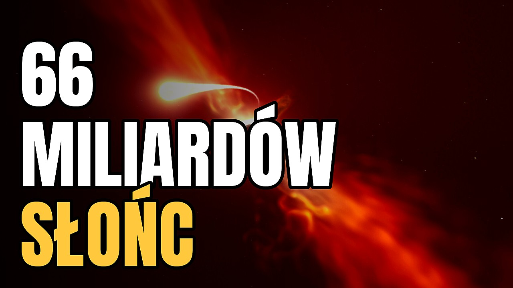
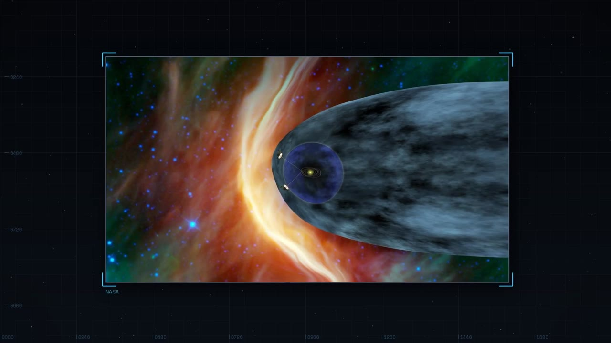
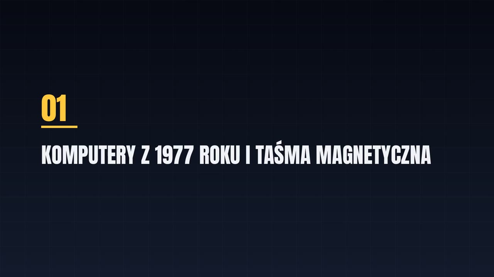
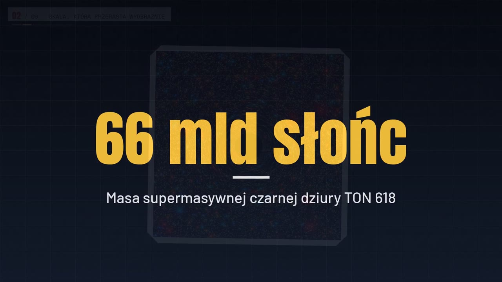
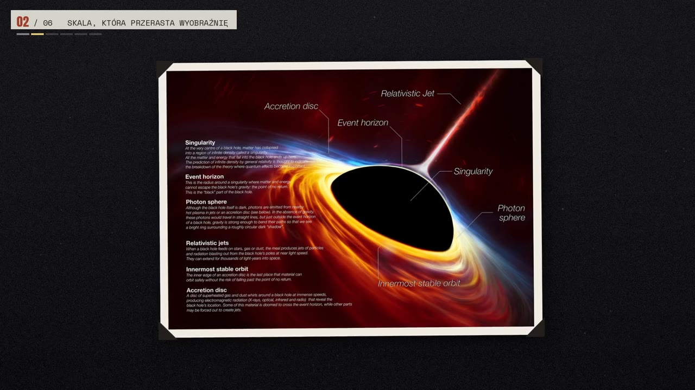

# YT Studio: a self-running YouTube channel

[](https://www.youtube.com/@26horyzontzdarzen)

**An autonomous production pipeline that researches, writes, fact-checks, narrates, edits, scores and publishes 16-minute documentary videos about space, three times a week, with zero human input.**

It runs **Horyzont Zdarzeń** ("Event Horizon"), a Polish-language popular-science channel about black holes, stars, planets and space missions. Every few minutes the service checks the YouTube upload queue. If the next slot is empty, it produces a new episode from scratch and schedules it.

| | |
|---|---|
|  |  |

> 🛠 **Status:** live in production, publishing Wed / Fri / Sun at 15:00 CET.
>
> ▶️ **Channel:** [youtube.com/@26horyzontzdarzen](https://www.youtube.com/@26horyzontzdarzen) (in Polish), every episode produced end-to-end by this pipeline
>
> 🔒 **Closed-source.** The code is private. This repository is a technical case study.
>
> 💬 Happy to walk through the code and architecture in an interview.

---

## What it does

- **Picks its own topics.** An LLM proposes ideas using the channel's past performance (views per day). Ideas too close to earlier episodes are rejected by embedding similarity, and so are topics without enough usable footage.
- **Writes a script with a different shape every time.** Eight narrative structures (investigation, chronology, engineering teardown, myths vs facts, what-if, head-to-head, ranking, sense of scale), never one of the last three. An anti-template gate compares each script against previous ones.
- **Fact-checks itself.** Up to 40 checkable claims are extracted and verified against Google Search or Wikipedia. Wrong claims get rewritten, and a topic with too many doubtful claims is dropped.
- **Proofreads Polish.** Titles, chapter names and thumbnail text go through a dedicated language pass, so the narrator never reads something clumsy out loud.
- **Narrates.** Gemini TTS with three rotating voices (one voice per film), spoken chapter announcements, automatic removal of TTS artifacts, and word-level timing from speech recognition.
- **Directs and sources visuals.** Each sentence is split into 5-14 s shots. Footage comes from NASA (images and video), Wikimedia Commons, Pexels and Pixabay, is ranked against the sentence, and is picked by a vision model looking at the actual frames. No repeats, no clips with burned-in text or the wrong mission.
- **Edits.** Smooth Ken Burns motion, four rotating on-screen frame styles, chapter cards, number cards timed to the exact word, crossfades, loudness normalization and subtitles.
- **Scores the film.** Background music is **synthesized from scratch** for every episode (no licensing, no Content ID), in four rotating styles, and ducked automatically under the narrator.
- **Designs the thumbnail and publishes.** A vision model picks the hero image, text is laid out for maximum size, and the video is uploaded with scheduled publishing, chapters, sources and subtitles.

| | |
|---|---|
|  |  |
| *"Control room" frame style around an archive image* | *Chapter card, shown while the narrator reads the chapter title* |
|  |  |
| *Number card, appearing on the exact word* | *"Archive" frame style with the chapter bar* |

🎧 **Music samples** (generated, with narrator, as heard in the videos): [bells](docs/audio/music-bells.mp3) · [pulsar](docs/audio/music-pulsar.mp3) · [crystal](docs/audio/music-crystal.mp3) · [nebula](docs/audio/music-nebula.mp3)

---

## Architecture at a glance

A single **Python / FastAPI** service in Docker, deployed with **Coolify** on a small VPS (2 vCPU, 4 GB RAM). State lives in **SQLite** on a persistent volume. A scheduler tick advances a **resumable stage machine**:

```
every 10 min: tick()
  ├─ episode in progress?            → resume from the saved stage
  └─ fewer than N videos scheduled?  → start a new episode for the next free slot

topic → outline → script → factcheck → metadata → voice → visuals → render → gates → upload
```

Every stage persists its output, so a crash, redeploy or API limit just pauses the episode. The next tick picks it up exactly where it stopped, rendering included.

See **[ARCHITECTURE.md](ARCHITECTURE.md)** for the full breakdown.

---

## Engineering highlights

**Quality over silent degradation.**
When the vision model that picks footage is rate-limited, the easy fallback is to drop in generic stock clips. That quietly produced worse videos. The pipeline now treats a missing model answer as "wait and retry", never "use something worse". The schedule has a buffer, so waiting costs nothing, but a mediocre video costs viewers.

**Timing to the spoken word, not to an estimate.**
TTS output length is unpredictable, so proportional timing drifted by 5-10 seconds over a chapter. The narration is transcribed with faster-whisper and aligned back to the script with sequence matching, which gives exact sentence boundaries. Number cards are pinned to the moment the number is actually spoken.

**Cost-aware model routing.**
Free-tier keys are used first, with model rotation and per-model cooldowns (daily vs per-minute limits are handled differently). A prepaid key is the fallback. TTS chunks are cached on disk, so a limit hit halfway through narration never pays for the same audio twice. Visual matching runs on a **local multilingual embedding model** instead of a paid API: no daily cap, no cost.

**No repeated shots.**
Repetition was the most visible sign of automation. Candidates are deduplicated by perceptual hash (the same NASA image hosted on two sites is caught), the pool of "hero" shots is sized to the film's actual needs, and adjacent generic shots are merged into longer ones instead of cycling.

**Procedural music, zero copyright risk.**
Pads, drones, bell melodies, arpeggios and pulses are synthesized with NumPy. Each episode gets its own key, chord progression and melody from a seed, and ffmpeg's sidechain compressor ducks the music under the voice. It sits clearly below the narration but plays from first frame to last.

**Built for a 4 GB server.**
Transitions are rendered pairwise instead of in one giant filter graph, ffmpeg threads are capped, the speech model is freed after use, old renders are cleaned up automatically, and the music generator is chunked to keep peak memory low.

**Safe re-renders.**
Re-doing an episode keeps the old upload scheduled until the new one has finished uploading, so a publishing slot is never lost. A code-version fingerprint in `/health` confirms which build is running before anything is triggered.

---

## Tech stack

| Layer | Choice |
|---|---|
| Service | Python 3.12, FastAPI, SQLite, Docker, Coolify |
| LLM / vision / TTS | Google Gemini (text, vision, TTS), with model and key rotation |
| Speech recognition | faster-whisper (word timestamps) |
| Embeddings | fastembed, local multilingual MiniLM |
| Video | ffmpeg, OpenCV (sub-pixel Ken Burns), Pillow (cards, frames, thumbnails) |
| Audio | NumPy synthesis, ffmpeg sidechain compression, loudnorm |
| Sources | NASA Image & Video Library, Wikimedia Commons, Pexels, Pixabay, Wikipedia |
| Publishing | YouTube Data API v3 (resumable upload, scheduling, thumbnails, captions) |
| Notifications | Telegram Bot API |

---

## About

Built by **Bartłomiej Dobranowski**, Computer Science student.

- GitHub: [@xtfee](https://github.com/xtfee)
- LinkedIn: [bartlomiej-dobranowski](https://www.linkedin.com/in/bartlomiej-dobranowski/)
- Email: ecomdobranowski@gmail.com

*The source code is private. This repository documents the architecture and decisions. I am glad to walk through the actual codebase live.*
